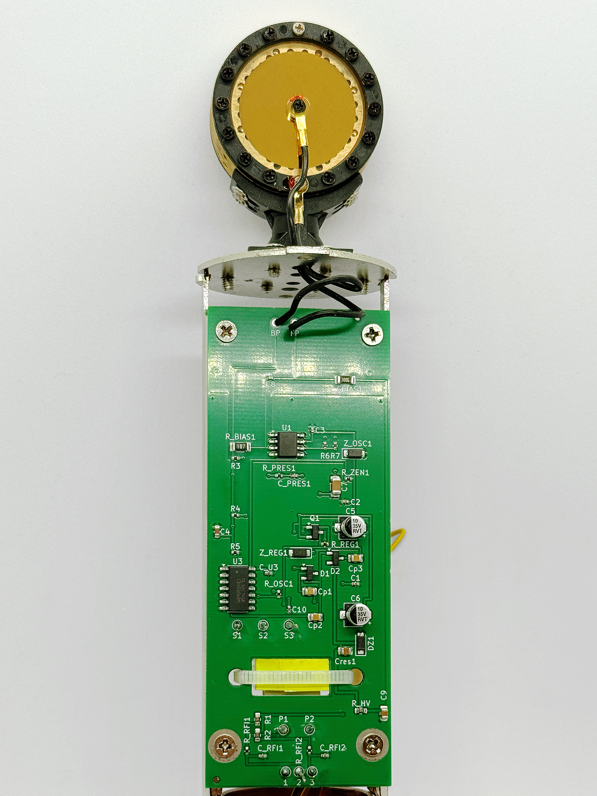
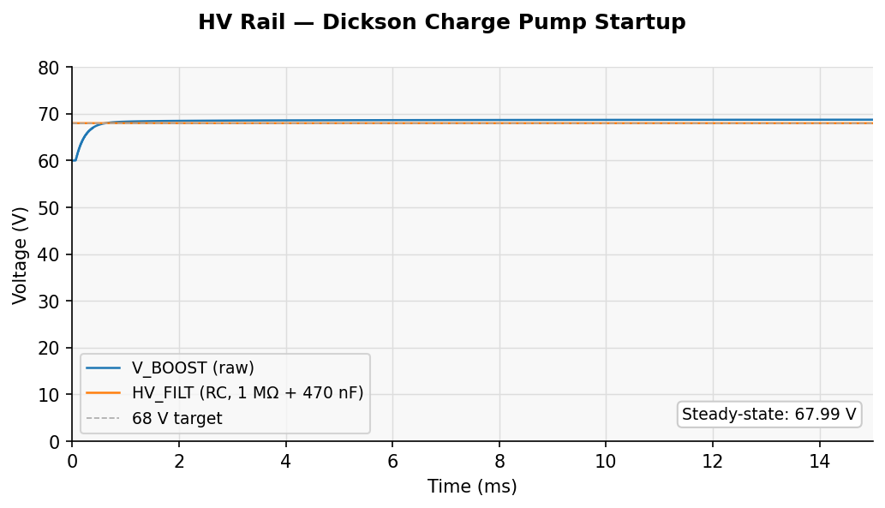
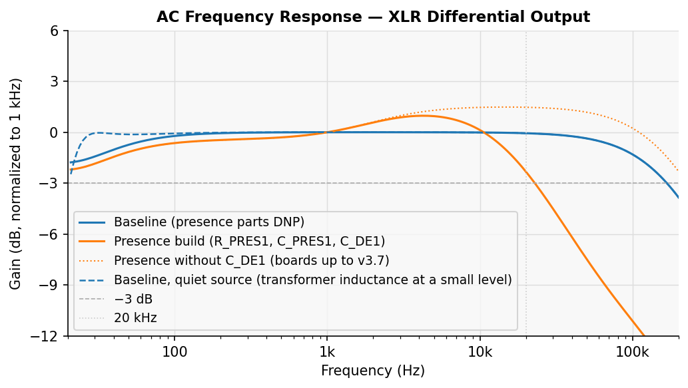
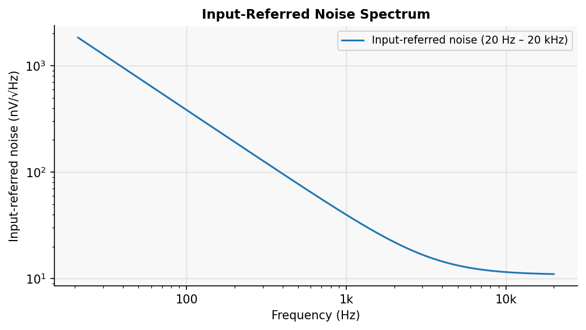
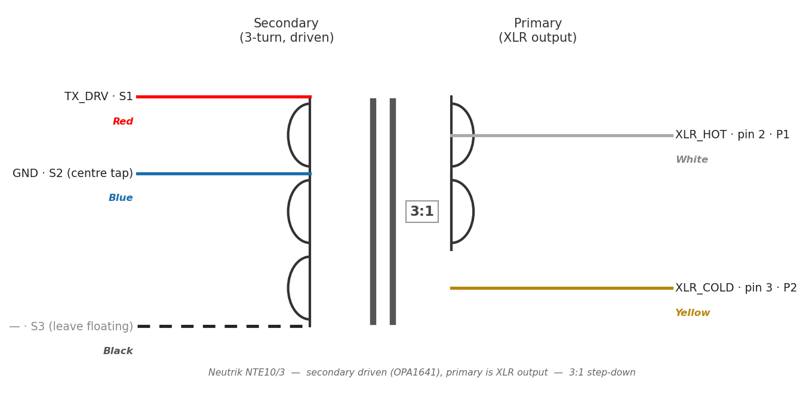
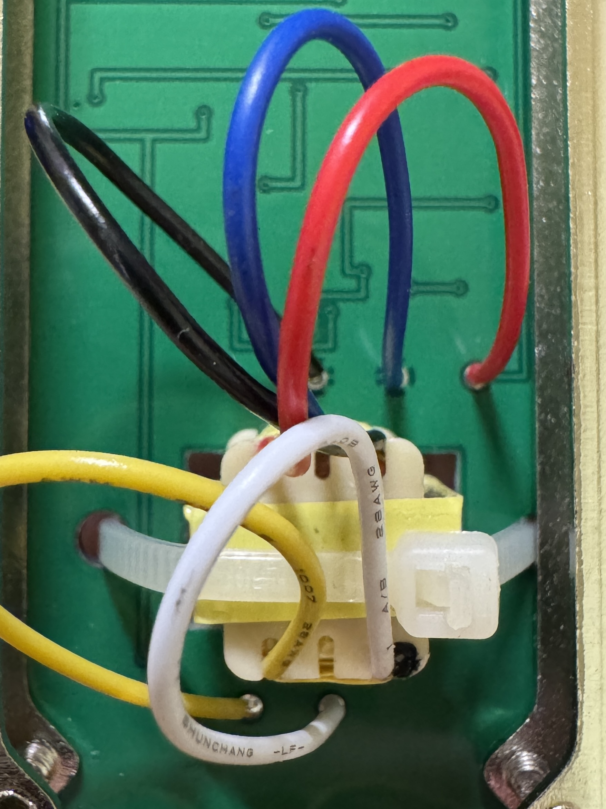

# Op-Amp Transformer Condenser Microphone

A code-driven open true condenser microphone. PCB layout, schematic, BOM, and CPL are all generated from Python scripts.



## Overview

This design uses a Dickson charge pump oscillator to generate a 68 V HV rail from 48 V phantom power, providing ~55 V capsule polarization (HV_FILT − 12 V midpoint), and feeds a transformer-coupled output stage built around a low-noise op-amp. The reference implementation uses the **OPA1641** (5.1 nV/√Hz, JFET input), chosen for its low voltage noise and LCSC availability. The circuit fits on a 36 × 93 mm 2-layer PCB.

**Key design points:**
- Op-amp output stage; reference design uses OPA1641 (5.1 nV/√Hz voltage noise)
- NTE10/3 audio transformer, 3.58:1 step-down as measured (data sheet: 3:1), transformer-coupled output
- CD40106B Schmitt-trigger oscillator + 3-stage active Dickson charge pump
- About 57 V capsule polarization (HV_FILT ≈ 69 V, set by the 15 V clock rail; a 75 V zener only protects it), referenced to the 12 V midpoint
- HV rail RC filter: 1 MΩ (R_HV) + 470 nF, corner ~0.34 Hz; no LC resonance
- Output sensitivity (simulated, 13 mV/Pa capsule, into a 1.5 kΩ preamp input): about −40 dBV/Pa default (R6 = 5.6 kΩ, gain ≈ 3.5×); about −24 dBV/Pa hi-gain (R6 = 47 kΩ, gain ≈ 22×). The transformer's values are measured on the part, since its data sheet gives only the turns (#137, `docs/transformer.md`). Capacitance from FP to ground that the circuit does not have (a lead, the housing close to FP) lowers them by about 0.14 dB per pF. About 1.3 dB lower into 600 Ω and 1.0 dB higher unloaded; output impedance is about 200 Ω (about 310 Ω up to v3.6, with 100 Ω RFI resistors; #113)
- Maximum SPL before the op-amp output clips (calculated): about 143 dB SPL peak at default gain, about 127 dB SPL peak at hi-gain. This holds from a few hundred hertz up. Below about 100 Hz the transformer distorts before the op-amp clips: mostly third harmonic, growing gradually with level and towards lower frequencies, more so at hi-gain. It is the part's own character, measured on the part in [docs/transformer.md](docs/transformer.md#distortion) and not tied to exact sound levels
- RFI filter on XLR output: 47 Ω + 220 pF on each leg (R_RFI1/R_RFI2, C_RFI1/C_RFI2; corner about 15 MHz). C_RFI is rated 100 V because it sits on the phantom-fed pins
- Phantom power draw: ~4.6 mA typical at 48 V (IEC 61938 P48 rated maximum: 10 mA)
- All SMD/THT components available from standard distributors (LCSC, Mouser, Digi-Key); capsule and transformer are customer-supplied

## Simulated Performance

Run with ngspice from `sim/` (see [Running Simulations](#running-simulations)):

| Parameter | Simulated | Notes |
|---|---|---|
| V_BOOST steady-state | 68.67 V | ideal 24 V and 15 V supplies; DZ1 (75 V) does not conduct. With the real `V_OSC` supply: 65.0 / 68.7 / 71.3 V at the low / nominal / high corners (`pump_real_vosc.sp`) |
| HV_FILT DC | 67.99 V | Sim models a 100 MΩ load to GND, giving a 0.68 V drop across R_HV. The real circuit has no DC load on HV_FILT (R_GBIAS1 feeds the capsule and C8), so it settles at V_BOOST, about 0.7 V higher. Small next to the spread of V_BOOST |
| HV_FILT ripple | ~47 nV p-p calc | RC at 100 kHz: −109 dB. The transient run cannot resolve it (HV_FILT ripple reads 0 once the slow rise of V_BOOST is taken out) |
| RC filter corner | ~0.34 Hz | R_HV=1 MΩ × C9=470 nF; no LC resonance |
| Capsule polarization | ~56 V | HV_FILT (68.0 V) − V_MID (12 V) at steady state |

### HV Rail Startup (`boost_dickson.sp`)



Charge pump settles to ~68 V within ~1 ms. HV_FILT is RC-filtered (1 MΩ + 470 nF); steady-state 68.0 V (0.68 V drop across R_HV), theoretical ripple ~47 nV p-p at 100 kHz (−109 dB). The simulation also runs an LC filter reference for ripple comparison (earlier board revisions used an LC filter before switching to the simpler RC approach); LC results are printed to the terminal but not plotted.

### AC Frequency Response (`amp_ac.sp`)



Behavioral model, gain normalized to 1 kHz. The **blue curve** (baseline / DNP) is flat within about ±1 dB from ~500 Hz to ~20 kHz. Two high-pass mechanisms shape the low end: the input network (R_GBIAS1 ∥ R_BIAS1 = 100 MΩ against the 55 pF capsule, corner ~29 Hz) and the output DC block (C_DC = 4.7 µF) with the transformer. A third sits below them: C_G1 (10 µF) in series with R3, corner 7.2 Hz, about 0.7 dB at 20 Hz. It makes the amplifier's gain 1 at DC, so offset and leakage at the 200 MΩ input do not move the operating point (`amp_dc_offset.sp`, #123).

> **Where the transformer's values come from.** The NTE10/3 data sheet gives the turns (1 : 3 : 10) and a response figure, and nothing else: no inductance, no winding resistance, no loss. So the model uses values measured on the part on its own (one unit; #137, `docs/transformer.md`):
>
> - turns 1 : 3.58 : 10.03. The full winding agrees with the data sheet; the tap section, which the default wiring drives, does not, and the output is 1.5 dB lower for it;
> - winding resistances 527 Ω (tap) and 41.8 Ω (output);
> - a magnetising branch of 17.9 H in series with 8.5 H ∥ 2.23 kΩ, fitted to the part's response with the output side open;
> - no core loss resistor: none shows in the levels.
>
> Against the whole microphone the model agrees in level (within 0.5 dB at 1 kHz), in the 8.8 dB between the two wirings (8.9), and in the response from 50 Hz up.
>
> **Below 50 Hz the response depends on how loud the source is.** The transformer's inductance falls with level, to about half for quiet sources, and with it the resonance with C_DC moves from 18 Hz to 25 Hz (measured through the board's own output network; the phantom supply's direct current has no effect). The model's branch takes a factor `K` for this: `K = 1` is the part as fitted at a larger level, `K = 0.41` reproduces the resonance measured at a small level. The plot shows both.
>
> | | 20 Hz | 30 Hz | 50 Hz | 100 Hz |
> |---|---|---|---|---|
> | measured, whole microphone, tap wiring, presence fitted, 1.2 kΩ, small level (relative to 1 kHz; #128) | −5.0 dB | −0.6 dB | −1.4 dB | −0.7 dB |
> | model, same conditions, `K = 0.41` (quiet source) | −3.5 dB | −0.3 dB | −0.5 dB | −0.5 dB |
> | model, same conditions, `K = 1` (loud source) | −1.9 dB | −1.8 dB | −1.2 dB | −0.6 dB |
> | model as plotted (baseline, no presence, 600 Ω), `K = 0.41` | −3.3 dB | 0.0 dB | −0.1 dB | −0.1 dB |
> | model as plotted, `K = 1` | −1.8 dB | −1.4 dB | −0.7 dB | −0.2 dB |
>
> The measured row is from another transformer and board than the one the values were taken from. `K = 0.41` assumes C_DC at its nominal 4.7 µF; only the product of the inductance and C_DC was measured in the network.
>
> The measured row is on a board with the presence network, which lowers the band below 1 kHz by about 0.4 dB against 1 kHz. On the full winding the measured response is −3 dB at 33 Hz and −5 dB at 20 Hz, set by the input network.
 The **orange curve** shows the optional presence-peak network populated: +2.6 dB shelving above f_c ≈ 2.1 kHz.

#### Optional presence-peak network (R_PRES1, C_PRES1)

R_PRES1 (6.2 kΩ) and C_PRES1 (12 nF) in series, parallel with R3 (2.2 kΩ), are footprinted on the board but **DNP by default**. If the capsule you use has a relatively flat frequency response and you'd like to add some presence lift, populate these two parts. The corner frequency and boost level can be tuned by adjusting their values:

- **Corner frequency**: f_c = 1 / (2π × R_PRES1 × C_PRES1) ≈ 2.1 kHz at the default values
- **HF shelf**: set by R_PRES1 ∥ R3; default +2.6 dB

`gen_bom.py` generates four BOM/CPL pairs in one run. The default build (`bom.csv` / `cpl.csv`, R6=5.6 kΩ, R_PRES1/C_PRES1 DNP) is packaged in the `fabrication-outputs` CI artifact. The three variant pairs (`-hi-gain`, `-presence`, `-hi-gain-presence`) are packaged in the `bom-variants` artifact.

| File suffix | R6 | Presence network | Notes |
|---|---|---|---|
| *(none)* | 5.6 kΩ | DNP | Default — more headroom, flat response |
| `-hi-gain` | 47 kΩ | DNP | Higher output level, transformer coloring |
| `-presence` | 5.6 kΩ | populated | Flat gain + +2.6 dB shelf above 2.1 kHz |
| `-hi-gain-presence` | 47 kΩ | populated | High-gain + presence lift |

### Input-Referred Noise Spectrum (`amp_noise_opa1641.sp`)



SPICE input-referred noise, computed by dividing total output noise by the signal transfer function at each frequency. The slope reflects the signal path's high-pass characteristic (coupling caps attenuate low-frequency signal more than noise), not a real frequency-dependent noise source. Below a few kHz the noise is set by the two 200 MΩ bias resistors (R_GBIAS1 and R_BIAS1): their thermal noise current flows into the capsule capacitance, so it falls with frequency. Simulated input-referred noise is 40 nV/√Hz at 1 kHz and about 12 nV/√Hz at 10 kHz, where the OPA1641 (5.1 nV/√Hz) and R_IN1 take over. The capacitance at the op-amp input (its own 6 pF common mode from the data sheet plus about 3 pF of layout strays, about 9 pF in all) divides the capsule signal but not the op-amp's noise, which raises the high-frequency part. A-weighted over 20 Hz–20 kHz this is about 2.3 µV, equivalent to about 18.9 dB(A) SPL for a 13 mV/Pa, 55 pF capsule.

Measured on a v3.7 board through a 47 pF dummy capsule: about 19.5 dB(A), 43 nV/√Hz at 1 kHz and 12 nV/√Hz at 10 kHz, against 20.0 dB(A), 45 and 12 simulated for that capacitance (#131). The figure is the same on the default and the full-winding wiring, and is uncertain by about ±0.5 dB from the interface gain calibration. A first measurement read about 1.3 dB higher because the injection lead ran outside the housing and loaded the input (#136). A v3.5 board measured 21.4 dB(A) in October (#114). A smaller capacitance shunts less of the bias resistors' noise, so a 47 pF dummy reads about 1 dB higher than a 55 pF capsule.

#### Bias resistor value (R_GBIAS1, R_BIAS1)

Both are 0805 and must be the same value. A higher value lowers the noise floor and the input corner, and makes the input node proportionally more sensitive to surface leakage (flux residue, humidity). 200 MΩ is the default as the balance point.

| Value (both) | Simulated self-noise | Input corner | Leakage sensitivity |
|---|---|---|---|
| 100 MΩ (up to v3.4.1, 1206) | 21.3 dB(A) | 59 Hz | 1× |
| **200 MΩ (default)** | **18.9 dB(A)** | **29 Hz** | **2×** |
| 470 MΩ (drop-in, e.g. Vishay CRCW0805470MJPEAHR) | 16.6 dB(A) | 12.5 Hz | 4.7× |

The 470 MΩ option is not a generated BOM variant; fit it by hand if wanted. Clean the area around C8, R_IN1, R_BIAS1 and U1 pin 3 thoroughly whichever value is used. Clean around R_OSC1, C10 and U4 pins 2 and 6 too: leakage at the oscillator's timing node stops the charge pump (#120).

## Hardware Characterisation

The figures above are simulated. [docs/measurement.md](docs/measurement.md) describes how to measure the DC rails with a multimeter, and the gain, frequency response and self-noise with an audio interface by driving the board through a capacitor in place of the capsule. `tools/measure/` holds the signal generator and the analysis script.

## Hardware Requirements

### Customer-supplied (not in PCBA BOM)
| Item | Spec | Notes |
|---|---|---|
| Capsule | Single-diaphragm condenser | Design delivers ~56 V polarization (HV_FILT ≈ 68.0 V − V_MID 12 V). Compatible with most standard large/small-diaphragm capsules; K47-type capsules (typically rated 40–60 V) are compatible at this voltage. |
| Transformer | **Neutrik NTE10/3** (1:3:10 on the data sheet, 1:3.58:10.03 measured) | Mouser / Newark. No other transformer is currently supported; the PCB cutout and solder pads are sized for this specific part. |

### Transformer wiring

The NTE10/3 has 5 free wires and connects to two sets of bare solder pads on the PCB (5 mm pitch). The circuit uses the transformer in reverse — the secondary (3-turn tap) is driven from the OPA1641 and the primary is the XLR output, giving a 3.58:1 step-down (measured).





Pad numbers run left to right as viewed from the **front** (component side). The photo above shows the board from the back, so left and right are mirrored.

**TP1 — 3 pads above transformer cutout (secondary, driven side)**

| Pad | Net | Wire colour |
|---|---|---|
| S1 (leftmost) | TX\_DRV | **Red** — 3-turn tap (signal in) |
| S2 (centre) | GND | **Blue** — centre tap (return) |
| S3 (rightmost) | — (floating) | **Black** — far end of winding; leave unconnected |

> **Full winding option:** swap S2 and S3 — connect **Black** (S3) to GND, leave **Blue** (S2) unconnected. This uses the complete secondary winding and reduces output level relative to the default by 8.9 dB from the measured turns (10.03 against 3.58), 8.8 dB as measured into a 1.2 kΩ input (#132). Combine with the `-hi-gain` BOM variant (R6 = 47 kΩ) to partially compensate for the lower sensitivity.

**TS1 — 2 pads below transformer cutout (primary, XLR output)**

| Pad | Net | Wire colour |
|---|---|---|
| P1 (leftmost) | XLR\_HOT (XLR pin 2) | **White** |
| P2 (rightmost) | XLR\_COLD (XLR pin 3) | **Yellow** |

### PCB
- 2-layer, 36 × 93 mm, ENIG or HASL
- All other components sourced from standard distributors; LCSC part numbers included in BOM
- 4 × M2.5 mounting holes with GND pads for chassis bonding — 28 mm horizontal span, 80 mm vertical span
- **MH3/MH4 mounting hardware must be electrically conductive** (metal standoffs and screws, not plastic). These two holes connect the PCB GND plane to the metal housing; plastic hardware breaks both the chassis ground bond and the EMC shielding path.

### Safety note — HV rail (IEC 62368-1)

The internal HV rail (VBOOST ≈ 68 V DC, HV\_FILT ≈ 68.0 V DC; at most 75 V +5%, where DZ1 clamps) is generated from 48 V phantom power by the Dickson charge pump and is entirely enclosed inside the microphone housing. It is **not connected to any externally accessible connector pin, contact, or exposed surface** under normal or single-fault conditions.

Under IEC 62368-1, a DC source in the 60–120 V range is classified as **ES2**. ES2 is permissible in a product provided that the source is not accessible to the user during normal operation; the sealed housing satisfies this requirement. The XLR output pins carry only the transformer-coupled signal and phantom supply (≤ 48 V, ES1), not the HV rail.

**Consequence for builders:** do not probe the HV rail while the board is powered from a live phantom source — treat it as you would any 68 V DC bus.

## Software Requirements

| Tool | Version | Purpose |
|---|---|---|
| Python | 3.8+ | PCB / schematic / BOM generation |
| KiCad | 9.0.x | PCB editor; provides `pcbnew` Python module |
| kicad-cli | 9.0.x | Gerber / drill export, DRC / ERC (bundled with KiCad) |
| ngspice | any recent | SPICE simulation (optional) |
| numpy | any recent | Simulation plot generation (`sim/plot_all.py`) |
| matplotlib | any recent | Simulation plot generation (`sim/plot_all.py`) |

## Generating Outputs

Run from the **project root** (the directory containing this README).

### 1. Generate KiCad files

```bash
python pcb/gen_project.py    # writes pcb/open-condenser-mic.kicad_pro
python pcb/gen_pcb.py        # writes pcb/open-condenser-mic.kicad_pcb
python pcb/gen_schematic.py  # writes pcb/open-condenser-mic.kicad_sch
```

All three scripts accept `--name PROJECT_NAME` to change the output filename (default: `open-condenser-mic`). After generating, open the project in KiCad via **File → Open Project** and select `pcb/open-condenser-mic.kicad_pro`.

A pre-rendered schematic PDF is available at [docs/schematic.pdf](docs/schematic.pdf). To regenerate it:

```bash
kicad-cli sch export pdf --black-and-white --output docs/schematic.pdf pcb/open-condenser-mic.kicad_sch
```

### 2. Export gerbers

`gen_pcb.py` fills all copper zones itself before writing the board file, so no manual zone-fill step is needed. Export gerbers and drill files via **File → Fabrication Outputs** in KiCad, or from the command line:

```bash
kicad-cli pcb export gerbers --output fab/ pcb/open-condenser-mic.kicad_pcb
kicad-cli pcb export drill   --output fab/ pcb/open-condenser-mic.kicad_pcb
```

Run DRC / ERC before fabricating:

```bash
kicad-cli pcb drc --severity-error --exit-code-violations pcb/open-condenser-mic.kicad_pcb
kicad-cli sch erc --severity-error --exit-code-violations pcb/open-condenser-mic.kicad_sch
```

### 3. Generate BOM and CPL

```bash
python pcb/gen_bom.py                    # → bom.csv / cpl.csv          (default: R6=5.6k, presence DNP)
python pcb/gen_bom.py --hi-gain          # → bom-hi-gain.csv / cpl-hi-gain.csv
python pcb/gen_bom.py --presence         # → bom-presence.csv / cpl-presence.csv
python pcb/gen_bom.py --hi-gain --presence  # → bom-hi-gain-presence.csv / cpl-hi-gain-presence.csv
```

## Running Simulations

All simulations use ngspice. Run from the `sim/` directory.

```bash
cd sim
ngspice boost_dickson.sp      # HV rail: VBOOST steady-state + ripple
ngspice amp_noise_opa1641.sp  # Input-referred noise, OPA1641 model
ngspice amp_ac.sp             # Closed-loop AC frequency response
ngspice amp_dc_offset.sp      # DC operating point against input offset and leakage (C_G1)
ngspice amp_bias_compare.sp   # Low-frequency rolloff vs R_BIAS1 value
ngspice phantom_ripple_psrr.sp # Phantom supply ripple → output hum
ngspice supply_dc_op.sp       # V_OPA regulator DC operating point across phantom/load corners
ngspice pump_real_vosc.sp     # Charge pump with a real V_OSC supply: DZ1 clamp current, V_OSC sag
```

### Regenerating plots

`sim/plot_all.py` runs the three main simulations and writes the plots embedded in this README to `img/`. Run from the project root:

```bash
pip install numpy matplotlib   # if not already installed
python sim/plot_all.py
```

## License

[CERN Open Hardware Licence Version 2 – Permissive (CERN-OHL-P)](https://ohwr.org/cern_ohl_p_v2.txt)
